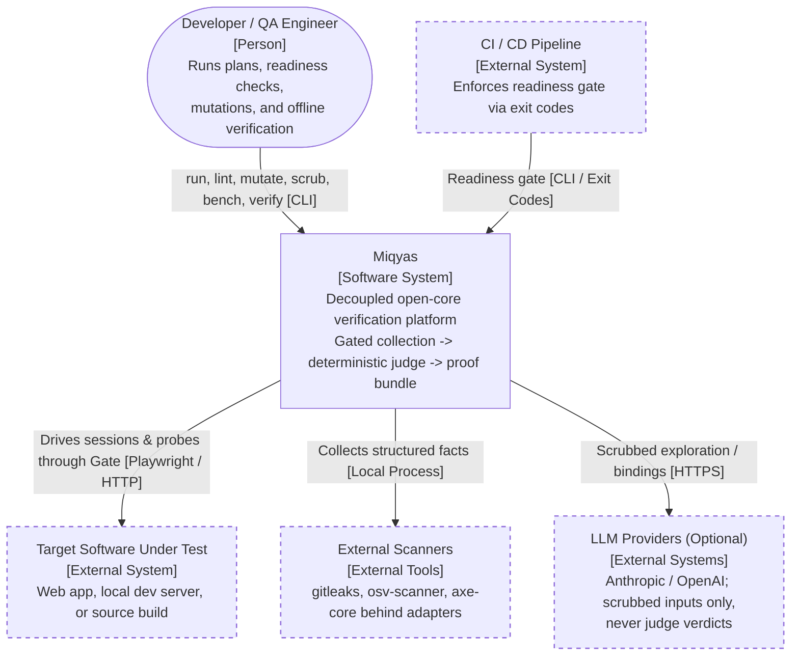
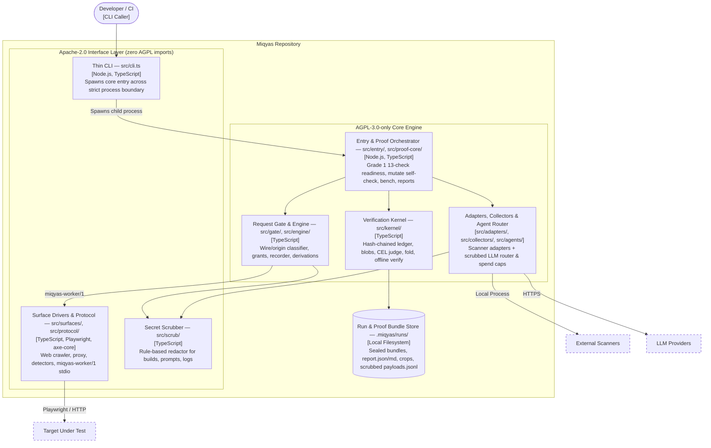
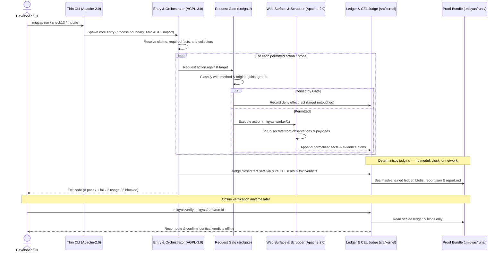
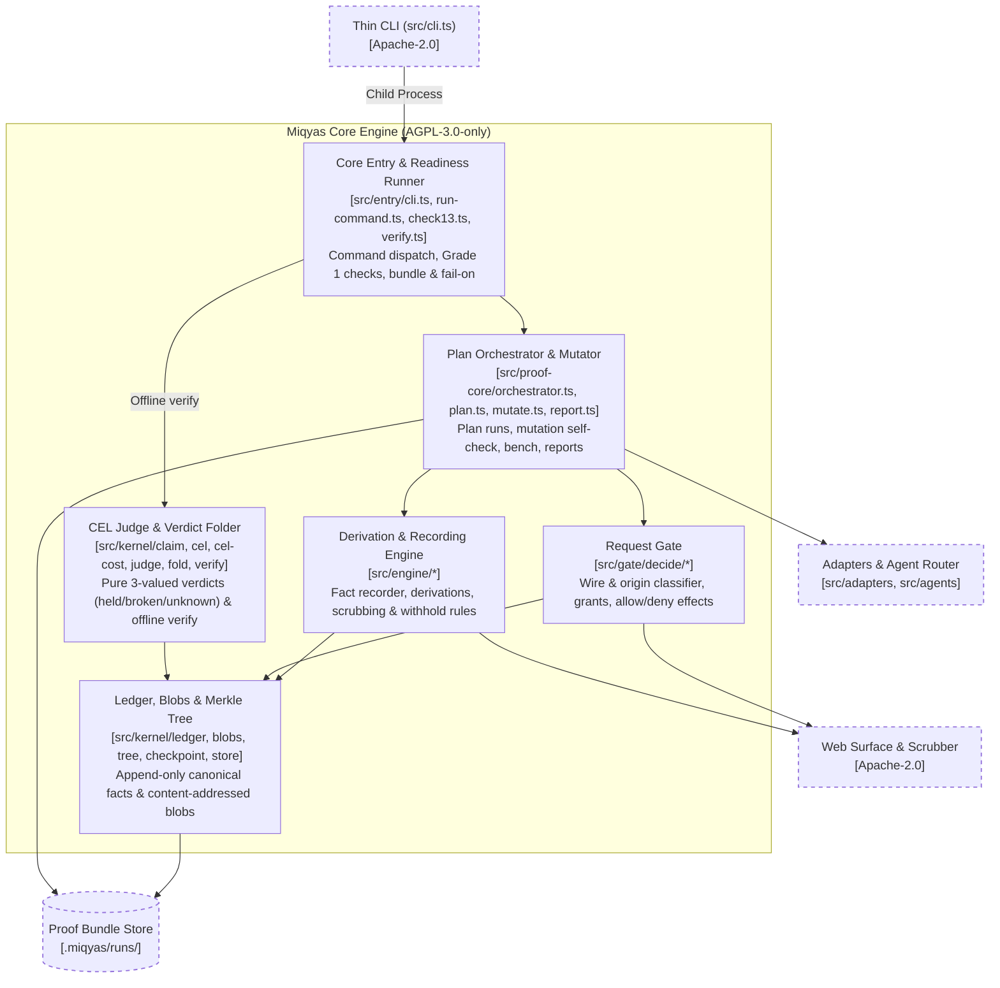

# Miqyas (مقياس)

Miqyas is a **verification platform**: the place any software passes through before anyone trusts it — web, mobile,
desktop, servers, and industrial or factory systems. It is not an MCP server and not a standalone agent.

Miqyas brings three parts together so every check leaves proof:

- **Proof core**: every check, from any source, ends in one verdict in the ledger with evidence and coverage.
- **Agent team**: agents that understand the software, author plans, explore states, run active checks, and inject
  faults on any surface.
- **Outside tools as adapters**: the runners and scanners you already trust (axe-core, gitleaks, osv-scanner, and
  more) plug in behind adapters and add facts. Judging is Miqyas's own code, and so, by design, is finding a defect
  by experiment ([docs/MAP.md](docs/MAP.md)).

Four ways in: one CLI command for a solo developer, a CI gate blocking release before `ready`, an MCP interface for a
coding agent to verify what it built, and self-hosted runs where source code and data never leave your network.

**What works today (Phase 1, web):** CLI, Playwright runner, assertion ledger, reports, mutate mode, and scrubber. The
Grade 1 web readiness profile (13 checks, 12 of them with no model call) is being built first to prove the proof core
and adapter layer end to end. Only the model calls you configure leave your machine, each one scrubbed and logged, and
source code never reaches a model. Expect rough edges and changing interfaces.

## Install and build

Node 20 or newer, and Playwright's Chromium.

```bash
npm ci && npm run build
npx playwright install chromium
node dist/cli.js doctor        # Node, browser, whether a model key is set
```

## Use

```bash
node dist/cli.js lint plans/wasl                          # offline plan check
node dist/cli.js run plans/wasl --url http://localhost:4173/ --scrub wasl-scrub
node dist/cli.js mutate plans/wasl --build <dist-mock> --preset wasl-tray --scrub wasl-scrub
node dist/cli.js import testsprite <testsprite/plans> --out plans/wasl
node dist/cli.js scrub <dist-mock> --rules wasl-scrub     # then re-scans; exit 1 if anything is left
```

`plans/wasl` and the `wasl-*` presets are the example plans and scrub rules from dogfooding Miqyas on the Wasl tray
window. Write your own plans in the same JSON format ([charter](docs/CHARTER.md), plan format).

Live runs read `ANTHROPIC_API_KEY` from your environment or from a git-ignored `.env` in the folder you run from (see
`.env.example`; set it yourself, Miqyas never asks for it, and a variable set in the shell wins). Without it,
`--dry-run`, `lint`, `mutate --dry-run` and the tests still work. Exit codes: 0 pass, 1 fail, 2 plan or usage error,
3 blocked or environment.

Runs go to `.miqyas/runs/<id>/`: `report.json`, `report.md`, evidence crops and screenshots, and `payloads.jsonl`
(every model call, scrubbed). Each report has a method block (versions, OS, model and run settings, preset, the scrub
rules file with its SHA-256 and term count, never the terms). `schema/report.schema.json` and
`schema/mutation-report.schema.json` describe the reports.

`bench wasl-tray [--repo <wasl clone>] [--commit <ref>] [--dry-run]` reruns the Wasl dogfood end to end: it exports
the app at a pinned commit with `git archive` (never writing inside your clone), builds the dev mock, scrubs the
build, runs the plans and the mutations, and writes `bench/<date>-<commit>/summary.md` and `summary.json`.

Tests: `npm test` (unit, offline) and `npm run test:e2e` (Chromium against a local fixture, scripted agent, no
network).

## Architecture (C4 + UML)

### System Context (C4 Level 1)



### Containers & Open-Core Boundary (C4 Level 2)



### Runtime Flow: Gated Verification & Offline Proof Replay (UML Sequence)



<details>
<summary>Level 3 — Component Diagram: Verification Kernel, Gate &amp; Proof Core</summary>



</details>

## Documents

- [Product requirements (PRD)](docs/PRD.md) and [software requirements (SRS)](docs/SRS.md)
- [Charter](docs/CHARTER.md): goal, readiness grades and profiles, the seven principles, plan format, roadmap
- The design being built next, not yet what the code does: the [map](docs/MAP.md) (the whole system on one page and
  what makes it strong), the [foundation](docs/FOUNDATION.md) (what makes a verdict trustworthy), the
  [experiment engine](docs/ENGINE.md) (how defects are found with nothing written in advance) and the
  [algorithms](docs/ALGORITHMS.md) (every function and formula).
- [Threat model](docs/threat-model.md): what Miqyas defends, what it may do to a target, what it never does
- [Decisions (ADRs)](docs/adr/) and the [glossary](CONTEXT.md)
- Numbers like "ticket 28" in the docs refer to Kahf's internal tracker.
- [Dogfood note](docs/dogfood/2026-10-29-wasl.md) and [research notes](docs/research/)

## Licence

Miqyas is open source under a **decoupled open-core** model (see [`docs/OPEN_MODEL.md`](docs/OPEN_MODEL.md)):

| Path | Licence |
|---|---|
| `src/proof-core/`, `src/adapters/`, `src/agents/`, `src/entry/`, `test/` | `AGPL-3.0-only` ([`LICENSE`](LICENSE)) — commercial dual-licences available from Kahf Labs |
| `src/protocol/`, `src/scrub/`, `src/surfaces/`, `src/cli.ts`, `scripts/`, `presets/`, `schema/` | `Apache-2.0` ([`LICENSE-APACHE`](LICENSE-APACHE)) |

No `Apache-2.0` module may import any `AGPL-3.0-only` module (`npm run lint` enforces both layer boundaries and per-file SPDX headers in CI).

## Contributing

Read [CONTRIBUTING.md](CONTRIBUTING.md) and the [code of conduct](CODE_OF_CONDUCT.md). Every pull request needs the
[contributor agreement](CLA.md); you keep your copyright. The names Kahf, Wasl, Qasd and Miqyas are not licensed for forks ([TRADEMARKS.md](TRADEMARKS.md)).

## Security

Report vulnerabilities, including any scrubber miss, privately: see [SECURITY.md](SECURITY.md). Do not open a public
issue.
